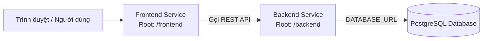

# CẨM NANG CẤU HÌNH BIẾN MÔI TRƯỜNG & TRIỂN KHAI LÊN RAILWAY (CHUẨN VINEX)

Hệ thống quản trị đơn hàng Shopee đa Tenant (Monorepo) gồm **Backend REST API (NestJS + Prisma)**, **Frontend (React + Vite)** và cơ sở dữ liệu **PostgreSQL**.

Hệ thống được thiết kế hoàn toàn tương thích với cơ chế **NIXPACKS** tự động của Railway giống dự án Vinex, khởi động cùng script `bootstrap.js` tự động đồng bộ Database schema mà không cần chạy lệnh thủ công.

---

## I. TỔNG HỢP BIẾN MÔI TRƯỜNG (DÙNG CHO RAW EDITOR TRÊN RAILWAY)

Khi tạo Service trên **Railway**, bạn chỉ cần vào tab **Variables** ➔ chọn chế độ **RAW Editor** và copy dán trực tiếp khối cấu hình tương ứng bên dưới vào:

### 1. Dành cho Service `backend` (NestJS REST API):

```env
# ==============================================================================
# 1. CẤU HÌNH HỆ THỐNG CỐT LÕI (CORE PRODUCTION)
# ==============================================================================
NODE_ENV=production
PORT=3000
HOSTNAME=0.0.0.0
DEFAULT_TIMEZONE=Asia/Ho_Chi_Minh

# ==============================================================================
# 2. TỐI ƯU HÓA QUÁ TRÌNH BUILD (NIXPACKS & PNPM ENGINE GIỐNG VINEX)
# ==============================================================================
NIXPACKS_NODE_VERSION=20
NODE_VERSION=20
NIXPACKS_PNPM_VERSION=9.15.9

# ==============================================================================
# 3. KẾT NỐI DATABASE POSTGRESQL TRÊN RAILWAY
# ==============================================================================
# Lưu ý: Prisma chỉ cần đúng DATABASE_URL (nếu DB của bạn đặt tên khác, hãy đổi ${{Postgres...}} tương ứng)
DATABASE_URL=${{Postgres.DATABASE_URL}}

# ==============================================================================
# 4. BẢO MẬT JWT & TOKEN ROTATION
# ==============================================================================
JWT_ACCESS_SECRET=shopee_order_prod_access_secret_key_999988887777_super_secure
JWT_REFRESH_SECRET=shopee_order_prod_refresh_secret_key_111122223333_super_secure
JWT_ACCESS_EXPIRATION=900s
JWT_REFRESH_EXPIRATION=7d

# ==============================================================================
# 5. CORS ALLOWLIST (HỖ TRỢ TẤT CẢ DOMAIN HOẶC DOMAIN FRONTEND RIÊNG)
# ==============================================================================
CORS_ORIGIN=*
```

---

### 2. Dành cho Service `frontend` (React + Vite SPA):

```env
# ==============================================================================
# 1. CẤU HÌNH HỆ THỐNG CỐT LÕI
# ==============================================================================
NODE_ENV=production
PORT=5173
HOSTNAME=0.0.0.0

# ==============================================================================
# 2. TỐI ƯU HÓA NIXPACKS BUILD
# ==============================================================================
NIXPACKS_NODE_VERSION=20
NODE_VERSION=20
NIXPACKS_PNPM_VERSION=9.15.9

# ==============================================================================
# 3. ĐỊNH DANH API BACKEND (BẮT BUỘC TRỎ VỀ DOMAIN CỦA SERVICE BACKEND)
# ==============================================================================
# Thay thế domain backend thực tế của bạn kèm theo hậu tố /api/v1:
VITE_API_BASE_URL=https://backend-production-xxxx.up.railway.app/api/v1
```

---

## II. HƯỚNG DẪN TẠO VÀ CẤU HÌNH TRÊN RAILWAY DASHBOARD

Dự án dạng Monorepo triển khai trong **1 Railway Project** gồm 3 thành phần:



### Bước 1: Khởi tạo Database PostgreSQL
1. Trong Railway Dashboard, bấm **+ Create** (hoặc **New Project**) ➔ chọn **Database** ➔ chọn **Add PostgreSQL**.
2. Railway tự động cấp một máy chủ PostgreSQL và sinh sẵn biến `${{Postgres.DATABASE_URL}}`.

---

### Bước 2: Triển khai Service `backend`
1. Bấm **+ Create** ➔ chọn **GitHub Repo** ➔ chọn repository `hieunt7702/order_management`.
2. Đổi tên service thành **`backend`**.
3. Vào tab **Settings**:
   - **Root Directory**: Điền `backend` (chữ thường).
   - **Builder**: Mặc định là **NIXPACKS**.
   - **Start Command**: Điền ` ` (đã cấu hình sẵn trong `Procfile` và `nixpacks.toml`).
4. Vào tab **Variables** ➔ Bấm **RAW Editor** ➔ Dán toàn bộ khối cấu hình ở **Mục I.1** vào.
5. Vào tab **Settings** ➔ mục **Networking** ➔ Bấm **Generate Domain** để nhận domain API (VD: `https://backend-production-xxxx.up.railway.app`).

> [!NOTE]
> Giống như Vinex, file `backend/scripts/bootstrap.js` sẽ tự động chạy trước khi khởi động ứng dụng:
> `npx prisma db push --skip-generate --accept-data-loss`
> Tự động đồng bộ toàn bộ 31 bảng dữ liệu vào PostgreSQL Railway mà không cần gõ lệnh thủ công.

---

### Bước 3: Triển khai Service `frontend`
1. Bấm **+ Create** ➔ chọn tiếp **GitHub Repo** ➔ chọn cùng repository `hieunt7702/order_management`.
2. Đổi tên service thành **`frontend`**.
3. Vào tab **Settings**:
   - **Root Directory**: Điền `frontend` (chữ thường).
   - **Builder**: Mặc định là **NIXPACKS**.
   - **Start Command**: Điền `pnpm run start` (hoặc `vite preview --host 0.0.0.0 --port $PORT`).
4. Vào tab **Variables** ➔ Bấm **RAW Editor** ➔ Dán khối cấu hình ở **Mục I.2** vào (nhớ điền đúng link backend ở Bước 2).
5. Vào tab **Settings** ➔ mục **Networking** ➔ Bấm **Generate Domain** để nhận link vào web app người dùng.

---

## III. HƯỚNG DẪN GẮN CUSTOM DOMAIN & CLOUDFLARE (NẾU CÓ TÊN MIỀN RIÊNG)

Nếu bạn gắn tên miền riêng cho hệ thống (ví dụ `domain.vn` và `api.domain.vn`):

1. **Cấu hình SSL/TLS trên Cloudflare:**
   - Trong Dashboard Cloudflare ➔ vào menu **SSL/TLS** ➔ **Overview**: Chọn chế độ **Full** hoặc **Full (strict)**.
   - *Tuyệt đối không chọn `Flexible` để tránh lỗi vòng lặp `ERR_TOO_MANY_REDIRECTS`.*
   - Vào **Edge Certificates** ➔ Bật nút **Always Use HTTPS**.

2. **Bản ghi DNS Cloudflare:**

| Loại (Type) | Tên (Name) | Target / Content | Proxy Status | Chức năng |
|:---:|:---:|:---:|:---:|---|
| **CNAME** | `@` | Domain Railway cấp cho frontend (VD: `frontend-xxx.up.railway.app`) | **Proxied** (Cam) | Web App chính |
| **CNAME** | `www` | Domain Railway cấp cho frontend | **Proxied** (Cam) | Redirect www |
| **CNAME** | `api` | Domain Railway cấp cho backend (VD: `backend-xxx.up.railway.app`) | **Proxied** (Cam) | Cổng REST API |

---

## IV. TÀI KHOẢN ĐĂNG NHẬP MẶC ĐỊNH & KHỞI TẠO MỚI

Khi truy cập vào đường dẫn Frontend:

- **Email**: `admin@shopee.vn`
- **Mật khẩu**: `Admin@123456`
- **Quyền hạn**: `OWNER` (Toàn quyền quản trị)
- **Workspace mặc định**: `DEFAULT_TENANT` (Hệ Thống Quản Lý Bán Hàng)
- **Kho mặc định**: `WH_MAIN_01` (Kho Tổng Trung Tâm)

*(Hoặc trên trang đăng nhập, bạn có thể click nút **"+ Khởi tạo Workspace mới (Bootstrap)"** để tự tạo một tài khoản và công ty hoàn toàn mới theo tên của bạn).*

---

## V. CÁC LỆNH TIỆN ÍCH DỮ LIỆU ĐÃ TÍCH HỢP

```bash
# 1. Xóa sạch 100% dữ liệu database (TRUNCATE CASCADE toàn bộ 31 bảng)
pnpm run prisma:clear

# 2. Tạo tài khoản Admin sạch (Không có đơn ảo / test)
pnpm run prisma:seed:admin

# 3. Nạp dữ liệu mẫu 3 Tenant (HN, HCM, ĐN) kèm các đơn hàng test (nếu cần demo)
pnpm run prisma:seed

# 4. Kiểm tra build cả FE và BE
pnpm run build
```
