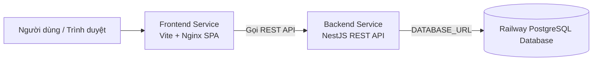

# HƯỚNG DẪN BUILD & DEPLOY TOÀN BỘ HỆ THỐNG LÊN RAILWAY

Tài liệu này hướng dẫn chi tiết cách deploy đồng thời cả **Backend (NestJS + Prisma)** và **Frontend (React + Vite + Nginx)** cùng cơ sở dữ liệu **PostgreSQL** lên nền tảng đám mây [Railway.app](https://railway.com).

---

## I. TỔNG QUAN KIẾN TRÚC TRÊN RAILWAY

Dự án dạng Monorepo gồm 3 dịch vụ liên kết trong 1 Project của Railway:



| Service | Thư mục nguồn (Root Directory) | Builder | Cổng / Port | Chức năng |
| :--- | :--- | :--- | :--- | :--- |
| **Database** | *(Railway Database)* | PostgreSQL 16 | 5432 | Lưu trữ toàn bộ dữ liệu nghiệp vụ |
| **Backend** | `/backend` | Dockerfile | Railway gán động `$PORT` | REST API, Prisma ORM, Auth, Quét xuất kho, Báo cáo |
| **Frontend** | `/frontend` | Dockerfile | Railway gán động `$PORT` | Giao diện quản trị SPA, Nginx routing fallback |

---

## II. CÁC BƯỚC TRIỂN KHAI TRÊN RAILWAY (CHI TIẾT)

### Bước 1: Tạo Project mới trên Railway
1. Đăng nhập vào [Railway Dashboard](https://railway.com/dashboard).
2. Bấm nút **"New Project"** -> Chọn **"Deploy from GitHub repo"**.
3. Chọn Repository chứa mã nguồn dự án này.

---

### Bước 2: Thêm Database PostgreSQL
1. Trong màn hình Project của Railway, bấm **"+ Create"** -> chọn **"Database"** -> chọn **"Add PostgreSQL"**.
2. Railway sẽ tự động tạo một database PostgreSQL chạy ngầm và cung cấp biến môi trường `DATABASE_URL`.

---

### Bước 3: Cấu hình Backend Service
1. Bấm **"+ Create"** -> chọn **"GitHub Repo"** -> chọn cùng Repository này.
2. Bấm vào Service vừa tạo, đổi tên thành **`backend`**.
3. Vào tab **Settings**:
   - **Root Directory**: Nhập `backend`
   - **Build**: Railway sẽ tự nhận diện `backend/Dockerfile`
4. Vào tab **Variables** và thêm các biến môi trường sau:

| Tên biến | Giá trị gợi ý | Ghi chú |
| :--- | :--- | :--- |
| `DATABASE_URL` | `${{Postgres.DATABASE_URL}}` | Bấm nút **Add Reference** để trỏ trực tiếp vào database PostgreSQL vừa tạo |
| `NODE_ENV` | `production` | Chạy chế độ production |
| `JWT_ACCESS_SECRET` | `shopee_prod_access_secret_key_999988887777` | Khóa bảo mật JWT (ít nhất 32 ký tự) |
| `JWT_REFRESH_SECRET` | `shopee_prod_refresh_secret_key_111122223333` | Khóa bảo mật Refresh Token |
| `JWT_ACCESS_EXPIRATION` | `900s` | Hạn của Access token (15 phút) |
| `JWT_REFRESH_EXPIRATION` | `7d` | Hạn của Refresh token (7 ngày) |
| `CORS_ORIGIN` | `*` | Hoặc điền domain Frontend sau khi tạo: `https://frontend-xxx.up.railway.app` |

5. Vào tab **Settings** -> mục **Networking** -> Bấm **"Generate Domain"** để nhận URL Public (ví dụ: `https://backend-production-xxxx.up.railway.app`).

> [!NOTE]
> Khi Backend khởi động, `Dockerfile` đã được cấu hình tự động chạy lệnh `npx prisma migrate deploy` để tạo bảng trong PostgreSQL mà bạn không cần phải chạy thủ công!

---

### Bước 4: Cấu hình Frontend Service
1. Bấm **"+ Create"** -> chọn **"GitHub Repo"** -> chọn cùng Repository này.
2. Bấm vào Service vừa tạo, đổi tên thành **`frontend`**.
3. Vào tab **Settings**:
   - **Root Directory**: Nhập `frontend`
   - **Build**: Railway sẽ tự nhận diện `frontend/Dockerfile`
4. Vào tab **Variables** và thêm biến sau:

| Tên biến | Giá trị | Ghi chú |
| :--- | :--- | :--- |
| `VITE_API_BASE_URL` | `https://<DOMAIN_BACKEND_CỦA_BẠN>/api/v1` | **Bắt buộc** trỏ về domain của Backend Service ở Bước 3 kèm đuôi `/api/v1` |

5. Vào tab **Settings** -> mục **Networking** -> Bấm **"Generate Domain"** để nhận URL truy cập người dùng (ví dụ: `https://frontend-production-xxxx.up.railway.app`).

---

## III. TÀI KHOẢN ĐĂNG NHẬP MẶC ĐỊNH

Sau khi deploy thành công, bạn mở domain Frontend và đăng nhập bằng tài khoản Quản trị gốc đã được chuẩn bị sẵn:

- **Email**: `admin@shopee.vn`
- **Mật khẩu**: `Admin@123456`
- **Quyền hạn**: `OWNER` (Toàn quyền quản trị)
- **Workspace mặc định**: `DEFAULT_TENANT` (Hệ Thống Quản Lý Bán Hàng)
- **Kho mặc định**: `WH_MAIN_01` (Kho Tổng Trung Tâm)

*(Hoặc trên trang đăng nhập, bạn có thể click nút **"+ Khởi tạo Workspace mới (Bootstrap)"** để tự tạo một tài khoản và công ty hoàn toàn mới theo tên của bạn).*

---

## IV. CÁC LỆNH TIỆN ÍCH DỮ LIỆU ĐÃ TÍCH HỢP

Bạn có thể chạy các lệnh sau từ máy tính cá nhân hoặc trong Railway CLI:

```bash
# 1. Xóa sạch 100% dữ liệu database (TRUNCATE CASCADE toàn bộ các bảng)
pnpm run prisma:clear

# 2. Tạo tài khoản Admin sạch (Không có đơn ảo / test)
pnpm run prisma:seed:admin

# 3. Nạp dữ liệu mẫu 3 Tenant (HN, HCM, ĐN) kèm các đơn hàng test (nếu cần demo)
pnpm run prisma:seed

# 4. Kiểm tra build cả FE và BE
pnpm run build
```
