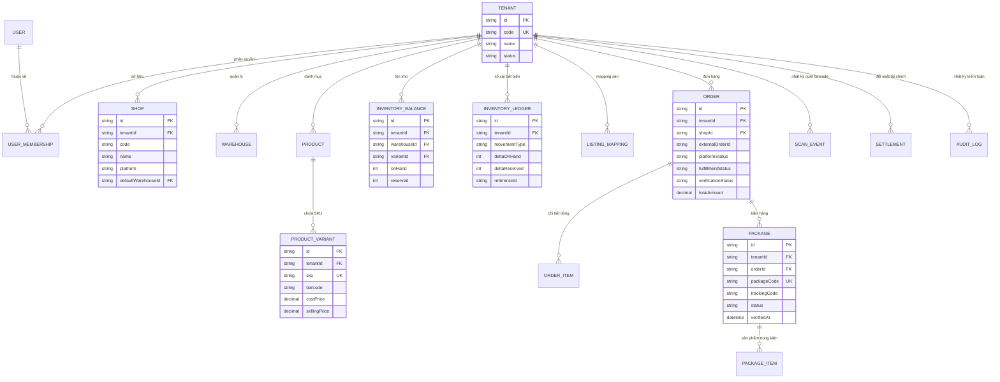

# Hệ Thống Backend Quản Lý Đơn Hàng & Kho Shopee Đa Tenant (Production-Ready)

Hệ thống REST API xây dựng bằng **NestJS (TypeScript Strict)**, **Prisma ORM**, **PostgreSQL**, **Redis**, **BullMQ**, **Docker Compose** và **OpenAPI/Swagger**, thiết kế theo kiến trúc Modular Monolith đáp ứng đầy đủ yêu cầu quản lý đa shop, phân lập đa tenant, kiểm soát kho hai chiều (on-hand / reserved / available), nhập đơn Shopee, quét barcode xác nhận xuất kho và đối soát tài chính.

---

## 1. Kiến Trúc & Sơ Đồ Thực Thể (ERD)

### 1.1 Sơ Đồ Thực Thể Quan Hệ (Mermaid ERD)



---

## 2. Bất Biến Nghiệp Vụ & Thiết Kế Đúng Đắn Dữ Liệu

1. **Phân lập Tenant tuyệt đối**:
   - `tenantId` không bao giờ lấy từ request body/query. Nó được giải mã từ JWT token và xác thực quyền trong `TenantGuard`.
   - Mọi câu truy vấn Database đều bắt buộc có `WHERE tenantId = :tenantId`.
   - Unique constraints composite: `[tenantId, code]`, `[tenantId, sku]`, `[tenantId, shopId, platform, externalOrderId]`.

2. **Sổ cái kho bất biến (Inventory Ledger)**:
   - `available = onHand - reserved`. Cấm tuyệt đối tồn âm.
   - Mọi biến động đều tạo bút toán mới trong `inventory_ledgers`. Không UPDATE/DELETE ledger cũ.
   - Cập nhật số dư và ledger trong cùng 1 Transaction với atomic conditional update.
   - Sắp xếp SKU theo thứ tự ổn định (`variantIds.sort()`) khi lock hàng để triệt tiêu Database Deadlock.

3. **Quét Barcode xác nhận xuất kho (2-Layer Deduplication)**:
   - Tầng 1: `Idempotency-Key` header với SHA-256 payload check.
   - Tầng 2: Ràng buộc trạng thái kiện hàng `UPDATE ... WHERE status != 'DISPATCHED'`.
   - Nếu mã khớp nhiều kiện hàng: Bắt buộc trả mã lỗi máy đọc được `AMBIGUOUS_CODE`, tuyệt đối không tự chọn bản ghi đầu tiên.
   - Quét mã chỉ xác nhận bàn giao nội bộ kho, không tự ý đổi trạng thái sàn thành SHIPPED.

4. **Hủy đơn & Nhập hàng hoàn**:
   - Hủy trước khi xuất: Tự động giải phóng `reserved`, ghi ledger `RELEASE`.
   - Hủy sau khi xuất: Giữ nguyên tồn kho; chỉ khi kho thực nhận hàng hoàn (`POST /orders/:id/receive-return`) mới cộng lại `onHand` và ghi ledger `RETURN_RECEIVE`.

5. **Tài chính & Doanh thu**:
   - Dùng `Decimal(15, 2)`, không dùng float.
   - Phân biệt rõ GMV, Doanh thu đơn hoàn thành (`COMPLETED`), Tiền thực nhận đối soát (`Settlement`) và Giá vốn snapshot (`COGS`).

---

## 3. Hướng Dẫn Cài Đặt & Chạy Môi Trường Local

### Yêu cầu tiên quyết
- Node.js >= 20.x
- pnpm >= 9.x
- Docker & Docker Compose (hoặc PostgreSQL & Redis cài sẵn)

### 3.1 Khởi động Hạ tầng Docker (PostgreSQL 16 & Redis 7)
```bash
cd backend
docker compose up -d postgres redis
```

### 3.2 Cấu hình Biến Môi Trường
Sao chép `.env.example` thành `.env`:
```bash
cp .env.example .env
```

### 3.3 Chạy Migration & Seed Dữ Liệu
```bash
# Sinh Prisma Client
pnpm prisma:generate

# Chạy migration database
pnpm prisma:migrate

# Seed 3 Tenant độc lập (Hà Nội, TP.HCM, Đà Nẵng)
pnpm prisma:seed
```

### 3.4 Khởi động Backend API
```bash
# Chế độ phát triển (Watch mode)
pnpm start:dev

# Hoặc chế độ production
pnpm build
pnpm start:prod
```
- API Base URL: `http://localhost:3000/api/v1`
- Swagger OpenAPI Docs: `http://localhost:3000/api/docs`

---

## 4. Tài Khoản Seed Minh Họa (3 Tenant Độc Lập)

| Tenant | Tên Workspace | Tài khoản OWNER | Mật khẩu | Kho hàng | Shop mẫu |
| :--- | :--- | :--- | :--- | :--- | :--- |
| **TENANT_HN** | Tập Đoàn Bán Lẻ Miền Bắc | `admin_hn@shopee1.com` | `Password123@Pass` | Kho Long Biên (`WH_HN_01`) | Shop Bách Hóa HN (`SHOP_HN_GROCERY`) |
| **TENANT_HCM** | Chuỗi Mỹ Phẩm Sài Gòn | `admin_hcm@shopee2.com` | `Password123@Pass` | Kho Tân Bình (`WH_HCM_01`) | Shop Mỹ Phẩm SG (`SHOP_HCM_BEAUTY`) |
| **TENANT_DN** | Thế Giới Phụ Kiện Đà Nẵng | `admin_dn@shopee3.com` | `Password123@Pass` | Kho Hải Châu (`WH_DN_01`) | Shop Cáp Sạc ĐN (`SHOP_DN_TECH`) |

*Ghi chú: Mỗi tenant còn có tài khoản nhân viên kho (`kho_hn@shopee1.com`) hoặc kế toán (`ke_toan_hcm@shopee2.com`) để kiểm tra phân quyền RBAC.*

---

## 5. Quy Trình Demo End-to-End Tối Thiểu

1. **Đăng nhập**:
   - `POST /api/v1/auth/login` với `{ "email": "admin_hn@shopee1.com", "password": "Password123@Pass" }`.
   - Nhận `accessToken`. Gắn vào header `Authorization: Bearer <accessToken>`.

2. **Xem số dư tồn kho**:
   - `GET /api/v1/inventory/balances` -> Thấy SKU `SKU-HAOHAO-120G` có `onHand: 150`, `reserved: 1`, `available: 149`.

3. **Upload File Đơn Shopee**:
   - `POST /api/v1/imports/upload` (Form-data: `file` chọn file Excel mẫu `Order.all.20260720_20260819.xlsx`, `shopId`).
   - Nhận `importJobId` và danh sách SKU chưa mapping (nếu có).

4. **Xem Preview & Xác nhận Import**:
   - `GET /api/v1/imports/:id/preview`.
   - `POST /api/v1/imports/:id/confirm` -> Hệ thống gom nhóm nhiều dòng, tạo đơn, packages và tự động giữ hàng (`reserve`).

5. **Quét Barcode Xuất Kho Thực Tế**:
   - `POST /api/v1/fulfillment/scan` với `{ "code": "SPXVN066144212957" }`.
   - Trả về mã `VERIFIED`. Tồn kho giảm `onHand` và `reserved`, ghi sổ cái `DISPATCH`.
   - Quét lại cùng mã: Trả về mã `ALREADY_VERIFIED` mà không trừ kho lần hai.

6. **Xem Báo Cáo Doanh Thu**:
   - `GET /api/v1/reports/dashboard` -> Xem các chỉ số GMV, doanh thu hoàn thành, tỷ lệ xuất kho, top sản phẩm và cảnh báo tồn thấp.

7. **Kiểm tra Đối soát Sổ Cái (Reconciliation)**:
   - `GET /api/v1/inventory/reconciliation` -> Xác minh tính toàn vẹn 100% giữa số dư thực tế và tổng phát sinh trong sổ cái bất biến.
